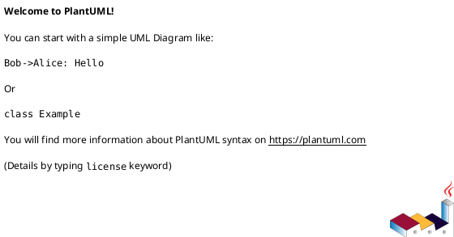
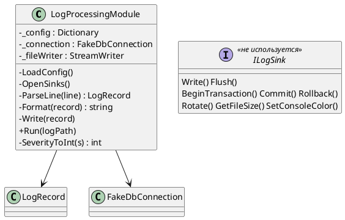
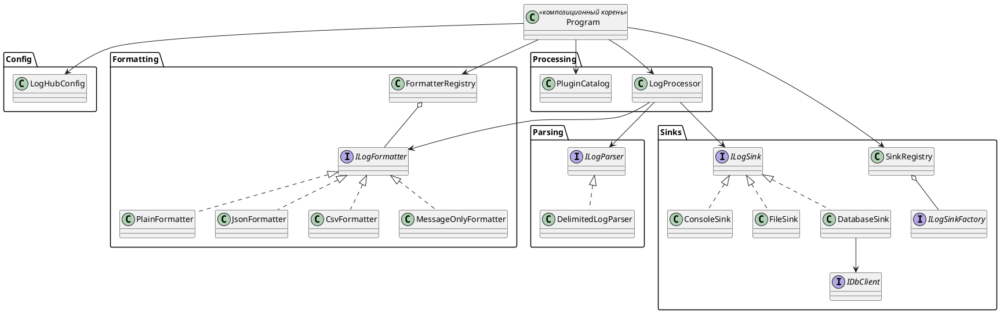

# Лабораторная работа 4 (ЛР 1 раздела «Паттерны»). Git, среда и SOLID

**Студент:** Нагорная Софья, БИСО-01-24
**Вариант:** 2 — CSV с заголовком, приёмники: консоль, SQLite (в этой работе пока консоль, файл и заглушка БД; SQLite придёт в следующих работах)
**Репозиторий:** ссылка
**Pull Request:** ссылка

---

## Задача

Настроить процесс работы с Git (форк, ветки, PR, CI) и завести каркас проекта LogHub. Затем взять god-класс `LogProcessingModule`, найти в нём нарушения SOLID и разрезать на слои так, чтобы поведение не изменилось, а новый приёмник добавлялся новым файлом.

---

## Разбор чужого кода

<!-- ЗАПОЛНИТЬ: выбрать любую папку паттерна в Implementation/, нарисовать диаграмму классов и написать полстраницы: какая задача решается и как. -->



Текст: _заполнить._

---

## Нарушения SOLID в `LogProcessingModule`

Номера строк — по файлу из учебного репозитория. «Помечено» — есть ли подсказка в комментарии.

| Принцип | Строки | Что не так | Помечено |
|---|---|---|---|
| SRP | 49–243 | один класс по шести причинам: формат конфигурации, хранилище, формат логов, формат вывода, список приёмников, правила фильтрации | частично |
| SRP / DIP | 242 | `Run` сам печатает итог в консоль; отчёт о работе смешан с обработкой | нет |
| OCP | 87, 174 | `switch` по приёмнику в двух местах, новый приёмник правит оба | да |
| OCP | 146 | `switch` по формату вывода | да |
| OCP | 248 | шкала уровней в `switch` | да |
| OCP / DRY | 192 | «Error» и «Critical» повторены строками, а порядок уровней описан отдельно в 248 | нет |
| LSP | 264–274 | «универсальный» `ILogSink`: консоль не умеет транзакций, БД не умеет ротации, реализация будет бросать `NotSupportedException` | да |
| ISP | 264–274 | тот же интерфейс слишком широкий; при этом нигде не используется | да |
| DIP | 36, 55, 64 | прямое чтение конфигурации с диска из логики | да |
| DIP | 40, 90 | конкретный `FakeDbConnection` создаётся внутри класса | да |
| DIP | 96 | имя файла от `DateTime.Now`, время не подменить | нет |
| DIP | 215 | `File.ReadLines` в `Run`: тест потребует настоящий файл | да |
| Контракт | 123, 128 | `ParseLine` возвращает `null`, из сигнатуры этого не видно | да |
| Контракт | 87, 146, 174, 211 | `_config["sink"]` и другие ключи бросают `KeyNotFoundException`, если в существующем файле конфигурации нет ключа | нет |
| Ресурсы | 239–240 | `Dispose` вручную без `try/finally`: исключение оставит файл открытым | да |
| Поведение | 255, 160 | неизвестный уровень молча считается «Info», неизвестный формат — «только сообщение» | нет |

---

## Диаграмма классов до



## Диаграмма классов после



---

## Применённые принципы

| Принцип | Где применён | Почему именно так |
|---|---|---|
| SRP | `LogHubConfig`, `DelimitedLogParser`, форматтеры, приёмники, `LogProcessor` | у каждого класса одна причина изменения: сменился формат логов — трогаем только парсер, новый вывод — только форматтер. Проверка «кто придёт с требованием»: администратор (конфигурация), эксплуатация (приёмники), аналитик (формат), и так далее, разные люди |
| OCP | `ILogSinkFactory` + `PluginCatalog` | приёмники находятся по интерфейсу в сборке, поэтому новый приёмник — один новый файл. Простой словарь в `Program.cs` пришлось бы править каждый раз |
| LSP | `ILogSink` | остался один метод `Write`, любой приёмник подставляется вместо другого без сюрпризов |
| ISP | `ILogSink` | из восьми методов оставил один; остальные (транзакции, ротация, цвет) никто не вызывал, отдельные интерфейсы под них не создавал |
| DIP | `LogProcessor`, `ConsoleSink`, `DatabaseSink` | зависят от `ILogParser`, `ILogFormatter`, `ILogSink`, `IConsoleOutput`, `IDbClient`; диск и консоль трогает только точка входа и фабрики |

---

## Ключевые решения

- **Фабрики приёмников и поиск по сборке.** Нужно было убрать `switch`, но так, чтобы добавление приёмника не меняло старые файлы. Обычная регистрация в `Program.cs` не подходит, она как раз правит существующий файл. Взял поиск реализаций через рефлексию (`PluginCatalog`). Минус: связь «имя в конфигурации → класс» стала неявной, ошибку в имени видно только при запуске.
- **Интерфейсы только там, где есть вторая реализация.** `ILogParser` нужен для тестов и для будущих форматов; `IDbClient` и `IConsoleOutput` нужны, чтобы проверять приёмники без консоли. А для шкалы уровней интерфейса нет: реализация одна и подменять её никто не будет.
- **Без `null` из парсера.** Вместо `ParseLine`, возвращающего `null`, сделал `TryParse` с `bool`: пропуск строки виден из сигнатуры.
- **Разделитель из конфигурации.** Требование варианта (разделитель полей задаётся конфигурацией) заложено сразу: `delimiter` читается в `LogHubConfig` и передаётся в парсер, по умолчанию «|», как в исходном коде.
- **Освобождение ресурсов через `using`** в `Program.cs`.

---

## Проверка OCP

Для проверки добавил файл `TelegramSink.cs` (заглушка, печатает в консоль) и выполнил:

```
git add -A
git diff --cached --name-only
```

<!-- ЗАПОЛНИТЬ: вставить сюда вывод команды. Должен быть один файл. -->

Кроме того, это проверяет тест `Registry_NewSinkFactory_IsUsedWithoutChangingExistingCode`.

## Проверка, что поведение не изменилось

<!-- ЗАПОЛНИТЬ: запустить исходный god-object и LogHub на одном файле, сравнить вывод (см. инструкцию), записать результат. -->

---

## Тесты

```
$ dotnet test
```

<!-- ЗАПОЛНИТЬ: вставить итоговую строку вида "Passed! - Failed: 0, Passed: N" -->

Тесты не трогают диск, сеть и базу: приёмники проверяются на `StringWriter` и записывающих заглушках, парсер — на строках. Всего 32 теста (с учётом вариантов в `Theory`) и один контрольный тест подключения проекта.

---

## Что не получилось

- Шкала уровней (`SeverityScale`) осталась в одном `switch`. Новый уровень — правка этого файла, то есть OCP здесь не соблюдён. Не стал усложнять: уровни меняются редко.
- Поведение изменено в одном месте: если файл конфигурации существует, но в нём нет какого-то ключа, раньше было исключение `KeyNotFoundException`, теперь берётся значение по умолчанию. Считаю это исправлением, а не изменением логики, но формально это отличие.
- Реальной работы с SQLite пока нет, только заглушка БД. Она нужна по варианту в следующих работах.
- Поиск через рефлексию — компромисс: он скрывает связи. На защиту готов объяснить, чем заменил бы его (регистрация в одном файле конфигурации DI).
- Сборку и тесты я не запускал в той среде, где писался код, поэтому в первую очередь проверял через CI; что получилось, записано выше.

---

## Источники

Исходный god-класс: репозиторий преподавателя `_AntiPatterns/GodObject/LogProcessingModule.cs` (только как входные данные, в решение не копировался). Заглушка `FakeDbClient` написана заново по образцу `FakeDbConnection` оттуда. Код рефакторинга подготовлен с помощью языковой модели (Claude) и проверен мной.
